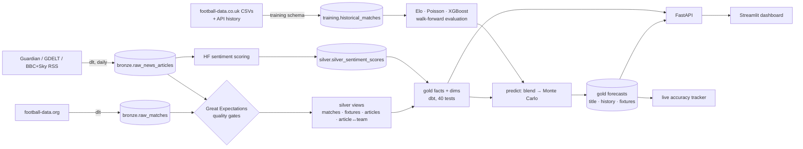

# ⚽ PLanalyst — Premier League News Sentiment vs Match Outcome Pipeline

[](https://github.com/aayanwth/planalyst/actions/workflows/ci.yml)

[](LICENSE)

An end-to-end data pipeline that ingests **Premier League match results** and **football news**, scores the coverage with **NLP sentiment analysis**, tests whether pre-match sentiment relates to results, and forecasts fixtures and the **title race** — served through a FastAPI layer and a Streamlit dashboard.

The modelling is evaluated honestly: leak-free walk-forward validation against baselines, calibration checks, a title-race backtest, and a live record of forecasts stored *before* each match. The headline finding is a sober one; see [Results](#-results).

---

## 🎯 Core Questions

1. Does pre-match media sentiment about a team correlate with how it performs?
2. Who is predicted to win the league, and how far can that forecast be trusted?

## 📌 Scope

- **Premier League only.**
- **Live pipeline data** (matches, news, sentiment) covers the **2026–27 season, Matchweek 1 onward**. Nothing older enters the live Bronze/Silver/Gold tables.
- **Historical seasons** are used **only** to train and evaluate the forecasting models, in a strictly separate `training` schema.

---

## 📊 Results

Everything here is generated by code in this repo; the linked reports have the full tables, confidence intervals and figures. Model details and limits: [`docs/model_card.md`](docs/model_card.md).

### Match-outcome forecasts — [`docs/model_evaluation.md`](docs/model_evaluation.md)

Walk-forward over 2,158 matches (seasons 2020–21 to 2025–26; each season is predicted from earlier seasons only):

| Model | Log loss ↓ | RPS ↓ | Accuracy |
|---|---|---|---|
| Class-frequency prior | 1.074 | 0.234 | 42.8% |
| Elo (with home advantage) | 0.997 | 0.205 | 52.7% |
| Logistic regression on Elo gap | **0.994** | **0.205** | 52.4% |
| Poisson goals model | 1.011 | 0.211 | 50.5% |
| XGBoost | 1.000 | 0.206 | 52.7% |
| **Served blend** (equal-weight XGBoost + Elo + Poisson) | 0.995 | 0.206 | 52.4% |

What this says, plainly:

- All the real models are far better than the naive baseline, but **none is distinguishable from a one-feature Elo model.** The served blend ties with logistic-on-Elo (paired bootstrap, CI includes 0) and is better than XGBoost alone (+0.005 log loss, CI excludes 0). Football results are noisy, and strength ratings capture most of what is predictable. Form features add nothing measurable over Elo.
- The blend is the **best calibrated** of the models (expected calibration error 0.016; reliability plots in the report).
- Elo gained a lot on the *validation* seasons from home advantage (0.974 → 0.952 log loss) but much less on the test seasons (1.000 → 0.997); 2020–21 had no crowds and almost no home advantage. Poisson was the best single model on validation and the weakest at match level on test. Settings were chosen on validation only, never on the test seasons; `python -m planalyst.ml.tune` reproduces every choice.
- **Title-race backtest** (six seasons, seven checkpoints each): the simulator behaves sensibly. Poisson-only fixtures gave the best title forecasts (mean Brier 0.252 vs 0.321 for the blend, 0.352 for Elo), but with one champion per season that is suggestive, not established.

### Sentiment vs performance — [`docs/sentiment_correlation.md`](docs/sentiment_correlation.md)

**Insufficient data.** Only 1 article so far is validly attributable to a match that has been played. An earlier version of the analysis reported n = 9 with weak, non-significant correlations; that number came from a bug (see below) that credited articles published *after* a match to that match. The analysis code is ready; it needs weeks of news, not more code.

### Bugs this work found and fixed

| Where | Problem | Found by |
|---|---|---|
| dbt attribution | Articles published after the last played match were credited to it, so post-result coverage counted as "pre-match" sentiment. | Reading the model against its own docstring; now covered by an integration test |
| dbt attribution | One team per article (first query wins); opponent in a head-to-head article got the same polarity | Inspecting real attributions |
| `ml/train.py` | Holdout left *later* seasons in the training set; random-fold CV leaked matches across folds; class weights and depth-6 trees overfit (1.065 → 1.001 log loss) | The walk-forward harness |
| `nlp/sentiment.py` | A missing description became the literal word "nan" in the text sent to the model | A unit test |
| API | A missing table made `/predictions/accuracy` return 500 instead of "no data yet" | A unit test |
| Harness | My own Poisson evaluation used the wrong team column (caught by a sanity check before it shipped) | Cross-checking against a hand computation |

---

## 🏗️ Architecture



Orchestrated by Dagster (`dagster dev -f planalyst/dagster_assets/definitions.py`):

| Job | Schedule (UTC, needs a running daemon) | Does |
|---|---|---|
| `news_ingestion_job` | daily 07:00 | RSS exposes only recent items, so news must be collected every day |
| `matchweek_pipeline` | Mondays 09:00 | ingest → Great Expectations → dbt (tests are fatal) → NLP → title/fixture forecasts, then two asset checks (probabilities sum to 1; every upcoming fixture has a forecast) |
| `model_training_job` | 1st of the month 06:00 | history load (API, then CSV backfill) → features → training |

## 🧰 Tech Stack

| Layer | Tool |
|---|---|
| Ingestion | dlt |
| Warehouse | PostgreSQL (pgvector image) |
| Transformation | dbt |
| Data quality | Great Expectations, dbt tests, Dagster asset checks |
| NLP | Hugging Face Transformers (`cardiffnlp/twitter-roberta-base-sentiment-latest`) |
| ML | XGBoost, scikit-learn (Elo, Poisson GLM, logistic baseline), MLflow |
| Orchestration | Dagster |
| Serving | FastAPI (pydantic response models) |
| Dashboard | Streamlit |
| Infra | Terraform, Docker Compose |
| CI | GitHub Actions: ruff + pytest, dbt + Dagster against Postgres, Docker builds |

## 🗂️ Data Sources

| Source | Purpose |
|---|---|
| football-data.org API | Live fixtures/results and (free tier, ~3 seasons) history. Season and competition are passed explicitly on every call. |
| Guardian Open Platform + GDELT (RSS fallback: BBC Sport, Sky Sports) | Full-text Guardian football articles and multi-outlet headlines per club, queried by date range; rejected if dated before the season start. |
| [football-data.co.uk](https://www.football-data.co.uk/) result CSVs | History back to 2015–16 for training and evaluation (`planalyst/ml/offline_data.py`). Only full-time scores are read; the bookmaker-odds columns are ignored. The two sources agree exactly on the seasons they share (1,140 matches). |

Table and column documentation: [`docs/data_dictionary.md`](docs/data_dictionary.md) (generated from the dbt schemas; a test fails if it drifts).

---

## 🚀 Getting Started

### Prerequisites
Docker, Python 3.11+, and API keys for [football-data.org](https://www.football-data.org/) and a free [Guardian Open Platform](https://open-platform.theguardian.com/access/) key (GDELT needs none) (the model evaluation needs neither).

### 1. Configure and install
```bash
cp .env.example .env            # add FOOTBALL_DATA_API_KEY and GUARDIAN_API_KEY
pip install -e ".[all]"         # or pick extras: ml, api, dashboard, nlp, orchestration, ... (see pyproject.toml)
```

### 2. Start the services
```bash
docker compose up -d --build    # Postgres (+pgvector), MLflow, API on :8000, dashboard on :8501
```
Override host ports with `POSTGRES_PORT`, `API_PORT`, `DASHBOARD_PORT` if they are taken, and the database password with `POSTGRES_PASSWORD` (it applies when the volume is first created). The Terraform route (`cd terraform && terraform apply`) provisions the same Postgres instance. Choose one of the two.

### 3. Load history, train, run
```bash
python -m planalyst.pipelines.historical_matches --source csv   # 2015+ history, no API key needed
dagster dev -f planalyst/dagster_assets/definitions.py          # then run model_training_job once, and matchweek_pipeline
```
If `matchweek_pipeline` is run before a model exists it stops with an instruction to train one.

### 4. Evaluate the model (no database or API key needed)
```bash
python -m planalyst.ml.report     # walk-forward evaluation + title backtest -> docs/model_evaluation.md (several minutes)
python -m planalyst.ml.tune       # every settings choice, on validation seasons only
```

### API
Interactive docs at `/docs`.

| Endpoint | Description |
|---|---|
| `GET /team/{team}/sentiment`, `/performance` | Per-team sentiment trend and results |
| `GET /matchweek/{n}/summary` | League-wide sentiment vs results for that week |
| `GET /predictions/title` | Title / top-4 / relegation probability and points range |
| `GET /predictions/history` | Title probability per scored matchweek (latest model version) |
| `GET /predictions/fixtures?matchweek=` | Home/draw/away forecast per fixture (default: next matchweek) |
| `GET /predictions/accuracy` | Forecasts stored before kick-off vs real results, against a naive baseline |
| `GET /health` · `GET /ready` | Liveness · readiness (checks the database; 503 if unavailable) |

---

## 🔮 Forecasting model

- **Elo** (`ml/elo.py`): one implementation for training, scoring, evaluation and backtest. Home advantage 90, draw rate 0.22, promoted teams start at 1450, no season regression (all selected on validation seasons).
- **Poisson goals model** (`ml/poisson.py`) and **XGBoost** (`ml/train.py`, depth 2, no class weights); features describe each team *before* its next match (leakage test included).
- **Blend** (`ml/predict.py`): equal weights. The validation grid showed every sensible blend within ~0.001 log loss of the best, so no weights are fitted.
- **Simulation**: 1,000 vectorised Monte Carlo runs of the remaining fixtures; winning margins are drawn from the empirical distribution of past results. Pass a seed for reproducibility.
- **Auditability**: `gold.title_prediction_history` (append-only) and `gold.fixture_predictions` (refreshed until kick-off, then frozen) make the live accuracy tracker a true out-of-sample record.

## 🧪 Quality

- **Tests:** 170 pytest tests (features, Elo, Poisson, leakage, metrics, simulator invariants, backtest, tuning and the report generator end to end, API on SQLite, ingestion parsers and the Guardian/GDELT mappers, dashboard chart builders, Dagster wiring, data-dictionary drift), including 8 dbt integration tests that build the models on a hand-made league in a real Postgres and check values worked out by hand. Line coverage is 57% in the fast CI job (CI floor 55%). Elo, Poisson, metrics, evaluation, backtest, the API routers and schemas, live accuracy and the prediction checks are at 91–100%; the report and tuning code at 84–89%; `predict.py` 71%; `features.py` and `train.py` about 45% (database loaders and artifact saving are untested). Not unit tested: Great Expectations wiring, network ingestion, the NLP model wrapper, the Dagster assets (their wiring is tested, not their bodies) and the dashboard pages themselves (their chart builders are unit tested; the pages were checked by rendering them against real data).
- **dbt:** 40 tests, including singular tests for result↔points consistency, non-decreasing cumulative points, pre-match attribution, head-to-head polarity symmetry, round-up exclusion, and source freshness checks.
- **Great Expectations** gates sit between Bronze and Silver and fail the pipeline loudly.
- **Live/training separation** is structural; verify with:
```sql
SELECT * FROM training.historical_matches WHERE season = 2026;  -- expect 0 rows
SELECT * FROM bronze.raw_matches WHERE season != 2026;          -- expect 0 rows
```
- **CI** (`.github/workflows/ci.yml`): ruff + pytest with a coverage floor; a job with a Postgres service running the dbt integration test, the Dagster tests, `dbt parse` and `dagster definitions validate`; Docker image builds.

```bash
pip install -e ".[ml,api,ingestion,orchestration,dev]" dbt-postgres
ruff check . && pytest                              # the dbt integration test skips itself without Postgres
PLANALYST_TEST_PG=localhost:5432 pytest             # include it (uses a scratch database)
```

## 🔐 Security notes

The API is read-only and unauthenticated (fine for a local project; put it behind a gateway before exposing it). CORS is an allow-list (`PLANALYST_CORS_ORIGINS`, default the local dashboard), not `*`. The Compose and Terraform defaults (`planalyst_dev`) are development values; set `POSTGRES_PASSWORD` for anything shared.

---

## ⚠️ Known Limitations

- **News is the weak link.** Only 25 articles over five matchweeks, almost all published after Matchweek 5, so one article is usable so far. Daily ingestion (now scheduled) will fix the volume over time. Articles are not filtered for relevance: women's football and the occasional NFL game at a Premier League ground are tagged to clubs.
- **Sentiment polarity is a heuristic.** "First-named club is the subject" works for typical headlines and is excluded for round-ups, but it has not been validated; `python -m planalyst.nlp.evaluate sample` exports headlines to label and `score <csv>` reports agreement. No labels ship with the repo because a person has to make them. The sentiment model itself (trained on tweets) is likewise unvalidated on football text.
- **Sentiment is not a match-model feature**; there is no historical news archive.
- **The match model does not beat Elo** (see Results); the dashboard's live accuracy page needs many matchweeks before it says anything.
- **Simulation holds form fixed** and treats team strength as known, so title odds are probably over-confident. Draw probabilities vary little between fixtures (forecast range 0.14–0.27).
- **Backfilled history** has no team ids or short names, and its `matchday` is a derived round number (up to 49 in 2020–21 because of postponements).
- **Not covered:** pgvector is enabled but nothing uses embeddings; Kafka/Redpanda streaming is not implemented; logging is still `print`-based; MLflow runs are only logged if `mlflow` is installed (`.[tracking]`); the Terraform path is neither exercised in CI nor validated here; the dashboard pages are not covered by automated UI tests; GitHub Actions itself has not run (the workflow's jobs were reproduced locally in clean environments).

## 🚫 Out of Scope

Multi-league support, betting-odds features (the evaluation ignores the odds columns in its source CSVs), and mixing historical training seasons into the live tables.

---

## 📁 Repository Structure

```
.
├── .github/workflows/ci.yml       # lint+tests, dbt+Dagster on Postgres, Docker builds
├── Dockerfile, docker-compose.yml # API + dashboard images; Postgres, MLflow, API, dashboard
├── docs/
│   ├── model_card.md              # intended use, method, limits
│   ├── model_evaluation.md        # generated: baselines, calibration, tuning, backtest
│   ├── sentiment_correlation.md   # generated from the live Gold table
│   ├── data_dictionary.md         # generated from dbt schemas + forecast tables
│   └── img/                       # figures used by the reports
├── scripts/                       # check_db.py, run_ge.py, generate_data_dictionary.py
├── terraform/                     # alternative Postgres provisioning
├── planalyst/
│   ├── pipelines/                 # dlt ingestion (live + historical, API or CSV)
│   ├── quality/                   # Great Expectations gates + prediction sanity checks
│   ├── nlp/                       # sentiment scoring + human-label evaluation
│   ├── ml/                        # elo, poisson, features, train, predict, evaluation, backtest, tune, report, live_accuracy
│   ├── analysis/                  # sentiment-vs-performance correlation
│   ├── api/                       # FastAPI routers + response schemas
│   └── dagster_assets/            # assets, asset checks, jobs, schedules
├── dbt_project/                   # silver/gold models, seeds (team names, aliases), tests
├── streamlit_app/                 # dashboard (6 pages: overview, title race, sentiment, team, fixtures, evaluation)
└── tests/                         # pytest suite + dbt fixture
```

## 📄 License

MIT — see [LICENSE](LICENSE).
