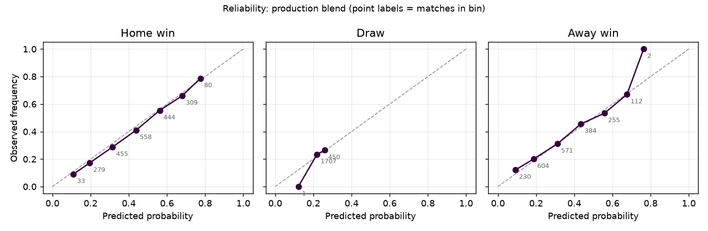
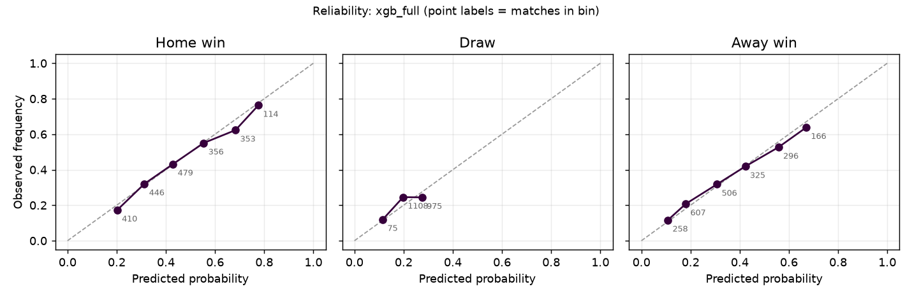
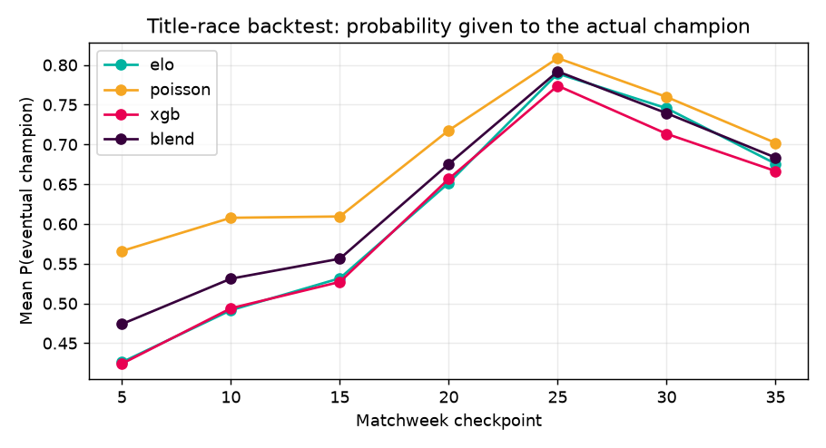

# Model evaluation

_Generated 2026-10-06 by `python -m planalyst.ml.report` · data: football-data.co.uk per-season results CSVs (full-time scores only)._

Everything below is produced by that command from a single run; nothing is hand-edited.
Seasons 2015–2025 are available. For each test season the model is trained on
**earlier seasons only** and scored on that season's matches (walk-forward), so no future
information reaches a prediction. Test seasons: 2020–2025
(2158 matches). The first match of each team's season is not scored because the
rolling features need at least one prior game.

## 1. Match-outcome model vs baselines

Probabilities are [P(home), P(draw), P(away)]. Lower is better for every column except accuracy.
RPS (ranked probability score) is the standard 1X2 forecasting metric.

| model | log_loss | rps | brier | accuracy |
|---|---|---|---|---|
| prior | 1.0741 | 0.2340 | 0.6506 | 0.4282 |
| elo_formula | 0.9971 | 0.2054 | 0.5939 | 0.5269 |
| logit_elo | 0.9939 | 0.2050 | 0.5917 | 0.5241 |
| poisson_glm | 1.0108 | 0.2111 | 0.6039 | 0.5046 |
| xgb_elo_only | 0.9996 | 0.2061 | 0.5955 | 0.5283 |
| xgb_form_only | 1.0295 | 0.2169 | 0.6168 | 0.4986 |
| xgb_full | 1.0004 | 0.2062 | 0.5960 | 0.5273 |
| blend | 0.9952 | 0.2056 | 0.5932 | 0.5241 |

**Models.** `prior` = training-set outcome frequencies. `elo_formula` = Elo expectation with home
advantage and a fixed draw rate. `logit_elo` = multinomial logistic regression on the Elo gap.
`poisson_glm` = independent-Poisson goals model (attack, defence, home effect). `xgb_full` = XGBoost on all
features. `xgb_elo_only` / `xgb_form_only` = ablations (Elo + venue only; everything except Elo).
`blend` = equal-weight mix of `xgb_full`, `elo_formula` and `poisson_glm` (xgb 0.33, elo 0.33, poisson 0.33), what
`predict.py` serves.

Log loss by season:

| season | prior | elo_formula | logit_elo | poisson_glm | xgb_full | blend |
|---|---|---|---|---|---|---|
| 2020 | 1.0971 | 1.0489 | 1.0576 | 1.0520 | 1.0462 | 1.0398 |
| 2021 | 1.0787 | 0.9783 | 0.9652 | 0.9670 | 0.9832 | 0.9693 |
| 2022 | 1.0508 | 0.9764 | 0.9777 | 1.0342 | 0.9827 | 0.9875 |
| 2023 | 1.0553 | 0.9436 | 0.9372 | 0.9482 | 0.9506 | 0.9415 |
| 2024 | 1.0798 | 0.9985 | 0.9923 | 1.0251 | 0.9997 | 1.0006 |
| 2025 | 1.0830 | 1.0374 | 1.0335 | 1.0386 | 1.0402 | 1.0326 |

### Is the difference real? Paired bootstrap

Negative `mean(A-B)` means A has the lower loss. Resampling matches 2,000 times gives a 95% interval.

| A | B | metric | mean(A-B) | 95% CI low | 95% CI high | reading |
|---|---|---|---|---|---|---|
| blend | logit_elo | log loss | 0.0013 | -0.0031 | 0.0053 | no clear difference on log loss (CI includes 0) |
| blend | logit_elo | RPS | 0.0006 | -0.0005 | 0.0017 | no clear difference on RPS (CI includes 0) |
| blend | elo_formula | log loss | -0.0020 | -0.0069 | 0.0026 | no clear difference on log loss (CI includes 0) |
| blend | elo_formula | RPS | 0.0002 | -0.0011 | 0.0014 | no clear difference on RPS (CI includes 0) |
| blend | poisson_glm | log loss | -0.0156 | -0.0223 | -0.0095 | blend is better on log loss (CI excludes 0) |
| blend | poisson_glm | RPS | -0.0055 | -0.0076 | -0.0036 | blend is better on RPS (CI excludes 0) |
| blend | xgb_full | log loss | -0.0052 | -0.0095 | -0.0011 | blend is better on log loss (CI excludes 0) |
| blend | xgb_full | RPS | -0.0006 | -0.0017 | 0.0005 | no clear difference on RPS (CI includes 0) |
| poisson_glm | logit_elo | log loss | 0.0169 | 0.0073 | 0.0269 | logit_elo is better on log loss (CI excludes 0) |
| poisson_glm | logit_elo | RPS | 0.0061 | 0.0031 | 0.0093 | logit_elo is better on RPS (CI excludes 0) |
| xgb_full | logit_elo | log loss | 0.0065 | 0.0019 | 0.0110 | logit_elo is better on log loss (CI excludes 0) |
| xgb_full | logit_elo | RPS | 0.0012 | 0.0004 | 0.0021 | logit_elo is better on RPS (CI excludes 0) |
| xgb_full | prior | log loss | -0.0737 | -0.0903 | -0.0567 | xgb_full is better on log loss (CI excludes 0) |
| xgb_full | prior | RPS | -0.0278 | -0.0333 | -0.0221 | xgb_full is better on RPS (CI excludes 0) |
| xgb_full | xgb_elo_only | log loss | 0.0008 | -0.0013 | 0.0028 | no clear difference on log loss (CI includes 0) |
| xgb_full | xgb_elo_only | RPS | 0.0001 | -0.0003 | 0.0005 | no clear difference on RPS (CI includes 0) |
| xgb_full | xgb_form_only | log loss | -0.0291 | -0.0408 | -0.0170 | xgb_full is better on log loss (CI excludes 0) |
| xgb_full | xgb_form_only | RPS | -0.0107 | -0.0145 | -0.0069 | xgb_full is better on RPS (CI excludes 0) |

## 2. Feature ablation

`xgb_full` vs `xgb_elo_only` and `xgb_form_only` above shows which feature group carries the signal.
Sentiment is **not** in this comparison: the historical seasons have no news archive, so sentiment
cannot be a training feature yet. It is studied separately in `docs/sentiment_correlation.md`.

## 3. Calibration

A calibrated model's points sit on the diagonal. ECE is the match-weighted mean gap between predicted
and observed frequency across 8 bins and 3 outcomes (lower is better).

| model | ECE |
|---|---|
| xgb_full | 0.0253 |
| blend | 0.0162 |
| logit_elo | 0.0187 |
| poisson_glm | 0.0174 |
| elo_formula | 0.0299 |

## 4. How the model settings were chosen

Every setting below was chosen on validation seasons 2018, 2019 (each
using only earlier seasons), which do not overlap the test seasons above. `python -m planalyst.ml.tune`
reproduces all four tables.

**Elo parameters** (grid of 480; top rows). Home advantage and the draw rate matter; season regression
and the promoted-team start barely do.

| home_advantage | season_regression | new_team_elo | draw_prob | log_loss | rps |
|---|---|---|---|---|---|
| 90 | 0.0000 | 1450 | 0.2200 | 0.9515 | 0.1964 |
| 90 | 0.0000 | 1400 | 0.2200 | 0.9515 | 0.1964 |
| 90 | 0.0000 | 1500 | 0.2200 | 0.9519 | 0.1965 |
| 65 | 0.0000 | 1450 | 0.2200 | 0.9520 | 0.1962 |
| 90 | 0.0000 | 1450 | 0.2000 | 0.9520 | 0.1963 |
| 90 | 0.0000 | 1400 | 0.2000 | 0.9521 | 0.1964 |

**Poisson goals model.** A plateau: several settings within 0.001 log loss of each other.

| alpha | half_life_seasons | log_loss | rps |
|---|---|---|---|
| 0.0001 | 0.5000 | 0.9442 | 0.1970 |
| 0.0010 | 0.7500 | 0.9443 | 0.1970 |
| 0.0001 | 0.7500 | 0.9444 | 0.1971 |
| 0.0010 | 1.0000 | 0.9447 | 0.1971 |
| 0.0001 | 1.0000 | 0.9448 | 0.1972 |
| 0.0001 | 1.5000 | 0.9456 | 0.1974 |

**XGBoost configuration** (refit with the Elo above):

| config | log_loss | rps |
|---|---|---|
| reference: logistic regression on Elo gap | 0.9454 | 0.1964 |
| depth 2, 200 trees, min_child_weight 10 | 0.9487 | 0.1984 |
| depth 2, 200 trees, min_child_weight 30 | 0.9488 | 0.1986 |
| production params (no class weights) | 0.9488 | 0.1986 |
| depth 3, 100 trees, min_child_weight 30 | 0.9514 | 0.1993 |
| depth 2, 100 trees, min_child_weight 30 | 0.9517 | 0.1992 |
| depth 2, 100 trees, min_child_weight 10 | 0.9519 | 0.1992 |
| depth 3, 100 trees, min_child_weight 10 | 0.9524 | 0.1993 |
| depth 4, 100 trees, min_child_weight 30 | 0.9524 | 0.1995 |
| depth 3, 200 trees, min_child_weight 30 | 0.9527 | 0.1996 |
| depth 3, 200 trees, min_child_weight 10 | 0.9529 | 0.1995 |
| depth 4, 100 trees, min_child_weight 10 | 0.9539 | 0.1997 |
| depth 4, 200 trees, min_child_weight 30 | 0.9557 | 0.2003 |
| depth 4, 200 trees, min_child_weight 10 | 0.9573 | 0.2005 |
| production params + class weights | 0.9668 | 0.1999 |
| legacy (depth 6, 300 trees, class-weighted) | 1.0386 | 0.2138 |

**Blend weights.** Fitting three weights on about 700 validation matches would mostly fit noise, and
the table shows why: the optimum is flat. Production uses equal weights, which are within a few
thousandths of the best combination.

| w_xgb | w_elo | w_poisson | log_loss | rps |
|---|---|---|---|---|
| 0.3000 | 0.1000 | 0.6000 | 0.9407 | 0.1960 |
| 0.4000 | 0.1000 | 0.5000 | 0.9407 | 0.1960 |
| 0.4000 | 0.0000 | 0.6000 | 0.9407 | 0.1962 |
| 0.3000 | 0.2000 | 0.5000 | 0.9408 | 0.1958 |
| 0.3000 | 0.0000 | 0.7000 | 0.9409 | 0.1962 |

## 5. Title-race backtest

For each test season and each checkpoint matchweek, the model is trained on earlier seasons, standings
and form are frozen at that point, the remaining fixtures are simulated (2000 runs) and the
title probabilities are compared with the real champion. `elo`, `poisson` and `xgb` use that single
component for every fixture; `blend` is the production equal-weight mix. The Poisson model is refit at each
checkpoint on earlier seasons plus the results so far, and winning margins are drawn from the empirical
distribution of past results.

Champions:

| season | champion |
|---|---|
| 2020-21 | Man City |
| 2021-22 | Man City |
| 2022-23 | Man City |
| 2023-24 | Man City |
| 2024-25 | Liverpool |
| 2025-26 | Arsenal |

Mean over seasons and checkpoints (Brier = Σ(p − 1[champion])² over all 20 teams; 0 is perfect):

| source | mean P(champion) | mean Brier |
|---|---|---|
| elo | 0.6159 | 0.3523 |
| poisson | 0.6816 | 0.2520 |
| xgb | 0.6079 | 0.3762 |
| blend | 0.6359 | 0.3213 |

Probability given to the eventual champion at matchweek 35:

| season | elo | poisson | xgb | blend |
|---|---|---|---|---|
| 2020 | 1.0000 | 1.0000 | 1.0000 | 1.0000 |
| 2021 | 0.6845 | 0.7280 | 0.6420 | 0.6855 |
| 2022 | 0.4550 | 0.5430 | 0.4670 | 0.4965 |
| 2023 | 0.2820 | 0.2755 | 0.2500 | 0.2705 |
| 2024 | 0.9995 | 0.9995 | 0.9995 | 0.9995 |
| 2025 | 0.6335 | 0.6655 | 0.6405 | 0.6485 |

**Caveat.** There is one champion per season, so this is 6 outcomes per checkpoint.
It can reveal a badly broken simulator; it cannot rank close alternatives with confidence.
